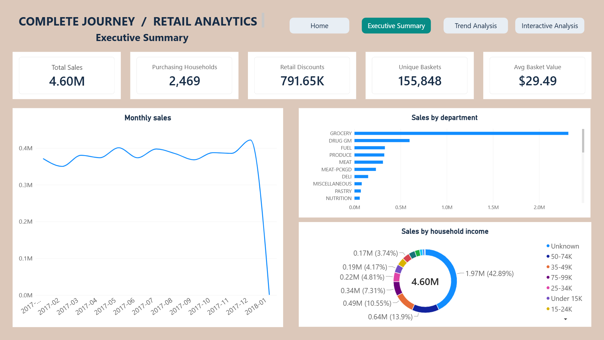

# Complete Journey Retail Purchasing Analysis

An academic group project that transforms grocery purchase records into validated sales, product category and household purchasing analysis using **Python, SQL Server, SSIS and Power BI**.

## Academic Context

Developed for the **IT3101 – Data Warehousing & Business Intelligence** module at the **Sri Lanka Institute of Information Technology (SLIIT)** by **Group 2026-DS-77**.

This four-member group project combines Python-based data preparation, SSIS staging loads, SQL Server warehouse transformations and interactive Power BI reporting.

## The Business Problem

Retail managers need a consistent view of sales, category performance and purchasing activity. However, transaction records, product descriptions and household information are held in separate datasets. Missing descriptions and different quantity units can also make comparisons misleading.

This project brings those records together, checks their quality and presents historical results through four connected dashboard pages. Managers can identify major sales contributors, examine recorded discounts and explore household purchasing patterns.

The solution supports business planning and investigation. It does not execute promotions or establish whether a campaign caused additional purchases.

## Results

| Measure | Recorded result |
|---|---:|
| Purchase lines | 1,469,307 |
| Purchasing households | 2,469 |
| Distinct shopping baskets | 155,848 |
| Recorded sales | $4,596,039.58 |
| Retail discounts | $791,650.64 |
| Average basket value | $29.49 |

These figures describe the project dataset. They do not represent revenue or profit improvements caused by the solution.

## What Was Built

- **Data preparation:** Converted seven R source files into Parquet, verified saved and reopened values, profiled data quality and exported verified CSV files.
- **Staging pipeline:** Used SSIS to load seven datasets into SQL Server staging tables.
- **Dimensional warehouse:** Built a sales fact table connected to date, product, household and store dimensions. Campaign descriptions are retained separately.
- **Controlled loading:** Implemented a full-refresh SQL loader with transaction handling, dimension-key validation and reconciliation checks.
- **Data mart:** Created a category-performance SQL view for monthly analysis across the product hierarchy.
- **Interactive reporting:** Developed Home, Executive Summary, Trend Analysis and Interactive Analysis pages in Power BI.

## Technologies Used

| Technology | Purpose |
|---|---|
| Python, pandas, PyArrow and pyreadr | Source conversion, profiling, preparation and validation |
| SQL Server | Dimensional modelling, warehouse loading, auditing and analytical queries |
| SQL Server Integration Services (SSIS) | Loading source datasets into staging tables |
| Power BI | Interactive dashboards and report navigation |
| Data Analysis Expressions (DAX) | Sales, discount, household and basket measures |

## Architecture

| Stage | Tool | Process and output |
|---|---|---|
| 1. Source data | Complete Journey dataset | Seven R files containing transactions, products, demographics and marketing records |
| 2. Preparation | Python | Convert to Parquet, profile data quality and export verified CSV files |
| 3. Staging | SSIS | Load the seven CSV datasets into SQL Server staging tables |
| 4. Warehouse | SQL Server | Load dimensions first, then sales facts, with key validation and reconciliation checks |
| 5. Data mart | SQL Server | Provide a category-performance view summarising sales and discounts by month and product hierarchy |
| 6. Reporting | Power BI | Analyse warehouse data through four interactive report pages |

**Data flow:** Source files → Python preparation → SSIS staging → SQL warehouse.

The warehouse supports two analytical outputs: the **category-performance SQL view** and the **Power BI report**. Power BI connects directly to the warehouse tables, rather than through the data mart view.

## Dashboard Pages

| Page | Purpose |
|---|---|
| Home | Introduces the report, provides navigation and explains key limitations |
| Executive Summary | Displays sales, households, baskets, discounts and average basket value |
| Trend Analysis | Compares monthly and quarterly results and explores household groupings |
| Interactive Analysis | Supports department and demographic filtering, with expansion from department to category and product type |

[View the dashboard gallery and measure definitions](powerbi/README.md).

## Business Findings

- **Grocery contributed approximately 50.4% of recorded sales.** This makes it a priority for availability monitoring and deeper category analysis.
- **Retail discounts totalled $791,650.64.** Managers can investigate where discounts are concentrated, without assuming those discounts caused additional sales.
- **Average basket value was $29.49.** Tracking this alongside basket counts helps distinguish changes in shopping activity from changes in spending per basket.
- **Demographic coverage was incomplete.** Unknown groups must remain visible, and findings about known households should not automatically be applied to all customers.
- **January 2018 was a partial period.** Comparisons should use complete periods or equivalent elapsed days before interpreting the apparent decline.

[Read the findings, recommendations and interpretation limits](docs/findings.md).

## Validation and Evidence

The project includes checks at multiple stages:

- Required source files and expected row counts.
- Exact values and data types after Parquet conversion.
- CSV row counts, column order, missing values and reopened values.
- Dimension-key resolution before loading sales facts.
- Warehouse reconciliation and comparison of report totals with SQL results.

Retained manifests and screenshots document the original project runs. Preparing this showcase repository did not include a fresh execution of SQL Server, SSIS or Power BI.

[Explore the validation evidence](docs/validation.md).

## Explore the Project

- [Setup and execution order](docs/setup.md)
- [Data model and loading design](docs/data-model.md)
- [Validation and evidence](docs/validation.md)
- [Business findings and recommendations](docs/findings.md)
- [Dashboard gallery and measures](powerbi/README.md)
- [Future work](docs/roadmap.md)
- [Dataset source and required files](data/README.md)
- [Team contributions](docs/contributions.md)

## Planned Enhancements

Potential extensions include:

- Campaign participation and coupon-redemption reporting.
- Additional household purchasing measures.
- Incremental loading and refresh automation.
- Automated pipeline testing, including failure and recovery scenarios.
- Historical dimension tracking using Slowly Changing Dimension Type 2, which preserves dated versions of descriptive attributes.

These enhancements are not part of the completed implementation. Measuring campaign impact would additionally require a defensible comparison method, rather than simply associating purchases with campaign dates.

[Read the development roadmap](docs/roadmap.md).

## Scope and Limitations

- Demographic coverage is incomplete; unknown groups are retained to preserve sales totals.
- January 2018 contains only a partial period.
- Source quantities are preserved, but quantities with different units should not be directly compared across departments.
- Sales records do not directly identify a campaign. Campaign attribution and causal impact measurement are not implemented.
- Recorded sales and discounts do not establish profitability or promotional effectiveness.
- This is a historical retail analytics project; no AI or machine-learning model is implemented.

## Dataset Attribution

The project uses the **84.51° Complete Journey** dataset, distributed through the `completejourney` project.

- [Dataset documentation](https://bradleyboehmke.github.io/completejourney/)
- [Original repository](https://github.com/bradleyboehmke/completejourney)
- [Required source files and preparation notes](data/README.md)

Source data is not redistributed in this repository. Dataset use remains subject to the original source terms.

## Team and Included Materials

This project was completed collaboratively by a four-member student team. See the [contribution statement](docs/contributions.md) for the available attribution information.

The showcase includes source code, aggregate validation evidence, documentation and dashboard screenshots. It excludes the data-bearing Power BI file and the academic report.

No open-source licence has been assigned to the project code. Contact the relevant authors for reuse permission.
