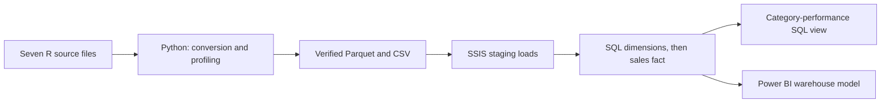

# Complete Journey Retail Purchasing Analysis

An academic group project that turns grocery purchase records into validated sales, category and household analysis using **Python, SQL Server, SSIS and Power BI**.

## The business problem
Retail managers need a consistent view of sales, category performance and purchasing activity. Transaction records and product and household descriptions arrive in separate tables. Missing descriptions and incompatible quantity scales can also make comparisons misleading.

This project brings those records together, checks their quality and presents historical results through four connected dashboard pages. It supports inventory, category and customer-analysis discussions; it does not execute promotions or establish campaign impact.

## Results
| Measure | Recorded result |
|---|---:|
| Purchase lines | 1,469,307 |
| Purchasing households | 2,469 |
| Distinct baskets | 155,848 |
| Recorded sales | $4,596,039.58 |
| Retail discounts | $791,650.64 |
| Average basket value | $29.49 |

These are descriptive results from the project snapshot, not demonstrated improvements in a retailer's revenue or profit.

## What was built
- Python conversion of seven R data files to Parquet, with saved-file readback checks, source profiling and verified CSV export.
- SSIS staging loads into SQL Server.
- A sales warehouse with date, product, household and store dimensions; campaign descriptions are retained separately.
- A transaction-protected full-refresh SQL loader with dimension-key checks and reconciliation checks.
- A category-performance SQL view for monthly product-hierarchy analysis.
- Power BI Home, Executive Summary, Trend Analysis and Interactive Analysis pages.

## Architecture

Power BI uses the warehouse tables. The SQL data mart is a separate analytical view.

## Explore the project
- [Setup and execution order](docs/setup.md)
- [Data model and loading design](docs/data-model.md)
- [Validation and evidence](docs/validation.md)
- [Business findings and recommendations](docs/findings.md)
- [Dashboard gallery and measures](powerbi/README.md)
- [Future work](docs/roadmap.md)
- [Dataset source and required files](data/README.md)
- [Team contributions](docs/contributions.md)

## Scope and limitations
Demographic coverage is incomplete, and unknown groups remain in the analysis to preserve totals. January 2018 is partial. Source quantities are retained but should not be compared across incompatible units. Sales records do not identify a campaign directly, so campaign attribution and causal lift are not implemented. The project is historical retail analytics, not an AI or machine-learning application.

## Attribution and included material
This is a group project; see the contribution statement. The dataset is the 84.51° Complete Journey dataset distributed through the completejourney project. Source data is not redistributed here. The public package contains source code, aggregate evidence and dashboard screenshots; it excludes the data-bearing PBIX and the academic report. No open-source licence is assigned in this package: code reuse requires permission from the relevant authors, and dataset use is subject to its source terms.
