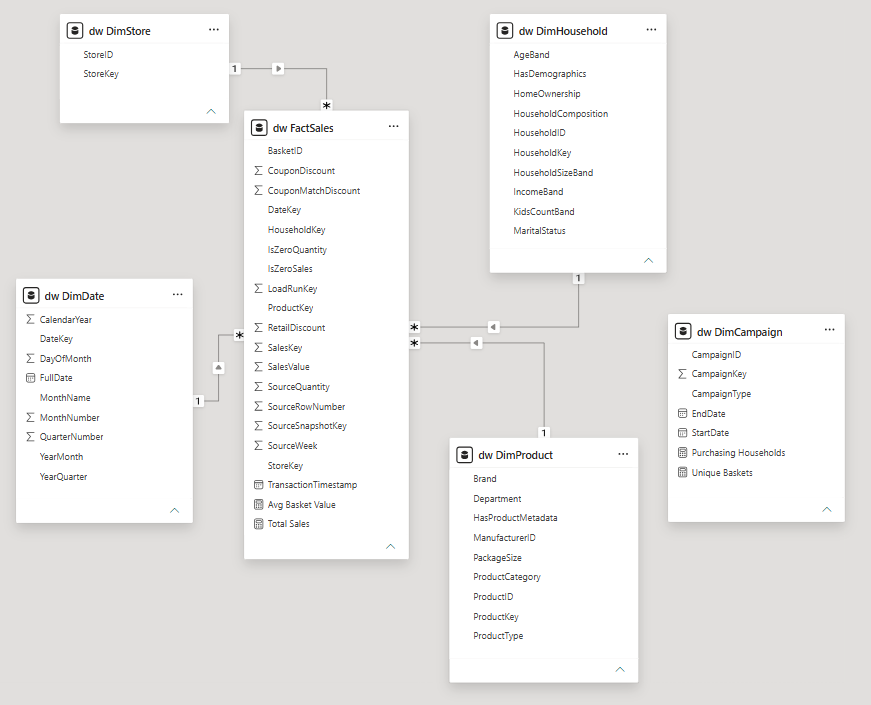

# Data model and loading design

The sales fact table has one row per product purchase line within a basket. Its measures include sales value, source quantity and the three recorded discount components. Basket IDs repeat across product lines; distinct basket counts are therefore used for transaction-level reporting.

The four related sales dimensions are Date, Product, Household and Store. Each dimension has a unique key linked to the corresponding foreign key in FactSales. In Power BI, these are active one-to-many relationships with single-direction filtering from the dimension to the fact.

DimCampaign retains campaign descriptions separately. FactSales has no direct campaign identifier; assigning campaigns by date alone would create unsupported attribution. Campaign and redemption reporting requires additional modelling.

The product hierarchy is Department → Product Category → Product Type. The date dimension supports month, quarter and year analysis. The SQL loader updates current descriptive attributes rather than retaining Type 2 historical versions. Historical attribute tracking would require effective dates and additional version-selection logic.

## Loading and referential integrity
SSIS first loads the seven staging tables. The SQL warehouse loader then loads descriptive dimensions before the sales fact. It checks dimension-key resolution before inserting facts, and fact-table foreign-key constraints enforce the relationships. Missing product metadata is represented using inferred dimension records, preserving sales instead of silently dropping them.

The load uses transaction handling and validation checks. It performs a full fact replacement, not an incremental append. Source filename and row ordinal are retained in Parquet, but the CSV export drops those provenance columns; warehouse lineage is therefore batch-level, not a complete original-row trace.

## Data mart
`mart.CategoryPerformance` is a standard SQL view grouped by month and the product hierarchy. It provides sales, discount components and source-quantity totals. It is not a separate physical database or a materialized table. Other business-specific marts can be added later. The Power BI report independently imports the warehouse tables to support flexible filtering and distinct counts.
