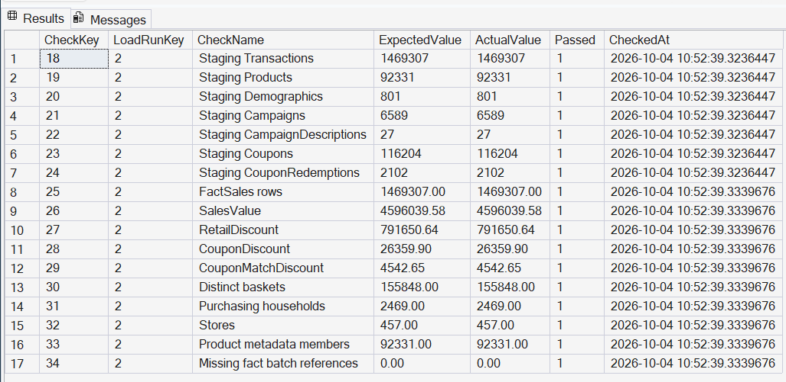

# Validation and evidence

These are retained project outputs, not results from a new run performed while preparing this folder.

| Layer | Implemented checks | Evidence |
|---|---|---|
| R → Parquet | Required files, expected rows, exact saved/reopened values and types | [Conversion manifest](../evidence/conversion-checks.json) |
| Parquet → CSV | Column order, row count, null positions and reopened values | [CSV export manifest](../evidence/csv-export-checks.json) |
| SSIS → staging | Successful staging task execution and staging profiling queries | [SSIS screenshot](../assets/ssis-load.png), `sql/data_profiling.sql` |
| Warehouse | Required keys, source expectations and 17 reconciliation checks | [Validation screenshot](../assets/warehouse-validation.png), `sql/verify_warehouse.sql` |
| Power BI | Totals compared with SQL; department filtering and clearing selections | Dashboard images and recorded interaction result below |

The recorded Grocery-filter check produced sales of 2,316,393.89; clearing selections restored 4,596,039.58. This interaction was confirmed during the project, rather than reproduced automatically during packaging.

## Quality findings
- 17 purchased products had missing metadata, affecting 4,836 purchase lines. Preserve their sales using inferred descriptions.
- Only 801 of 2,469 purchasing households had demographic profiles. Retain Unknown groups and qualify demographic conclusions.
- 13,510 lines had source quantity above 100: 11,830 Fuel, 1,679 Miscellaneous and one Produce. These were investigated and retained, not automatically treated as errors or rescaled.
- January 2018 is a partial period and should not be interpreted as a comparable full-month decline.

The code implements rollback on load failure. Retained successful execution evidence alone does not demonstrate a deliberately induced failure/rollback test. The hardcoded source hash is snapshot metadata; it must be checked against the input file before a reproduction run.
