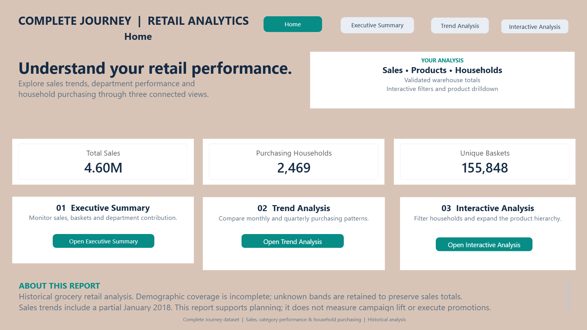
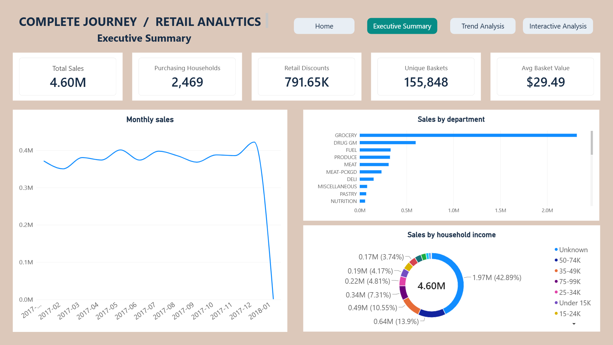
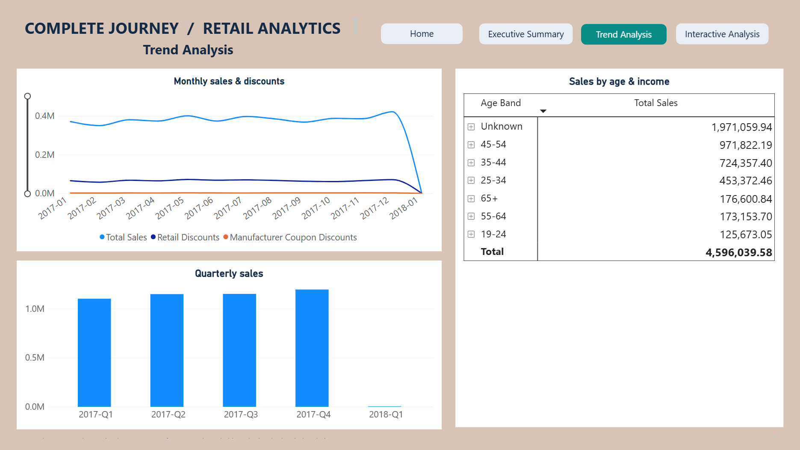
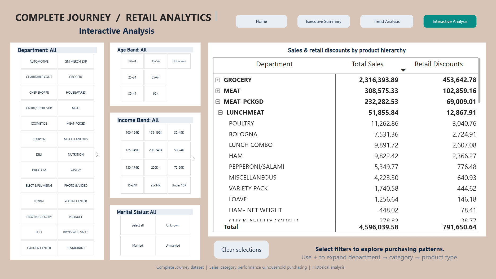

# Power BI dashboard gallery

The report has four pages. The screenshots are retained project visuals. The original data-bearing PBIX is deliberately excluded from this public package.

## Home
Navigation, project purpose and limitations.

## Executive Summary
Sales, households, baskets, retail discounts and average basket value, with department and demographic breakdowns.

## Trend Analysis
Monthly sales and discount components, quarterly sales and household grouping. January 2018 is partial.

## Interactive Analysis
Department and demographic slicers, clear selections, and Department → Category → Product Type expansion.

## Reproduction notes
Import `dw.FactSales`, `dw.DimDate`, `dw.DimHousehold`, `dw.DimProduct` and `dw.DimStore`. Use active one-to-many relationships on their matching keys, with single-direction dimension-to-fact filtering. DimCampaign is separate from the sales star.

[measures.dax](measures.dax) supplies reconstruction definitions using the displayed `dw FactSales` table name; adjust that name to your import. These definitions were documented from project formulas and source columns, not extracted as an exhaustive measure export from the embedded PBIX model.

For household and basket cards, use whole numbers and no display-unit abbreviation. Format average basket value as currency. A department selection makes average basket value selected-department sales per qualifying basket, not the full value of those shopping baskets. SQL view totals support reconciliation but the dashboard model uses warehouse tables directly.
